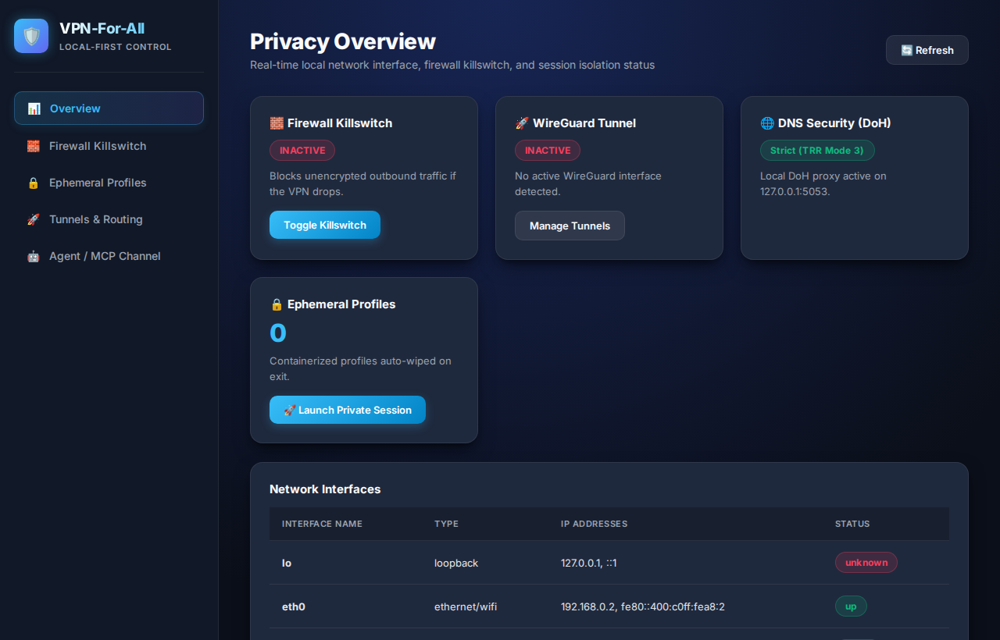

<div align="center">

# 🛡️ VPN-For-All
### Complete, Local-First Professional Privacy Routing, Session-Isolation & VPN Management Application

[](LICENSE)
[](#-platform-support)
[](#-crafting-apps-architecture)
[](#-zero-logging--ip-isolation-guarantee)
[](#-agent--mcp-control-channel)

*A professional, production-ready local privacy application for Windows and Linux that runs entirely on your local PC with **zero paid external servers, zero tracking, and complete user control**.*

---

### 🖥️ Interactive Web & Desktop Control Dashboard



---

### ⬇️ [Download Latest Release (.exe / Binary)](https://github.com/your-username/VPN-For-All/releases/latest)

</div>

---

## 🌟 Key Features

- 🖥️ **Interactive Desktop Control App & Web UI**: Control your firewall killswitch, WireGuard tunnels, and browser profiles directly via an intuitive GUI at `http://127.0.0.1:8080` or desktop launcher without copying or pasting CLI commands.
- ⚡ **Native CLI Engine**: Lightweight, web-view free CLI (`python3 -m core.cli status`) for high-performance scripting and terminal control.
- 🧱 **Zero-Leak Firewall Killswitch**: Automatically blocks unencrypted outbound traffic using system firewalls (`iptables`/`nftables` on Linux, `netsh advfirewall` on Windows) if the VPN tunnel drops.
- 🔒 **Ephemeral Browser Profile Isolation**: Spin up containerized Firefox/Mullvad browser windows pre-hardened with `user.js` and enterprise policies that wipe cache, cookies, and local storage on exit.
- 🌐 **Encrypted DNS-over-HTTPS (DoH)**: Cloudflare and Quad9 DoH forwarders listening locally on `127.0.0.1:5053`, completely bypassing local ISP DNS inspection.
- 🤖 **Agent & MCP Control Channel**: Built-in Model Context Protocol (MCP) server over standard JSON-RPC 2.0 stdio, allowing AI agents (e.g. Jules, Claude) to programmatically inspect and modify privacy routing state.

---

## 📥 Downloads & Executable Binaries

| Operating System | Download Link | Build Type |
|---|---|---|
| 🪟 **Windows (10/11)** | [⬇️ Download `VPN-For-All-Windows-x64.zip`](https://github.com/your-username/VPN-For-All/releases/download/v1.0.0/VPN-For-All-Windows-x64.zip) | Standalone `.exe` Package |
| 🐧 **Linux (x86_64)** | [⬇️ Download `VPN-For-All-Linux-x64.tar.gz`](https://github.com/your-username/VPN-For-All/releases/download/v1.0.0/VPN-For-All-Linux-x64.tar.gz) | Standalone Binary Package |

*Note: You can also build standalone binaries yourself on any system by running:*
```bash
python3 scripts/build_exe.py
```

---

## 🚀 Getting Started

### Option A: Launch Interactive App GUI (No Commands Needed)
1. Double-click **`launch_app.bat`** (Windows) or run **`./launch_app.sh`** (Linux).
2. Your browser will automatically open the interactive control dashboard at `http://127.0.0.1:8080`.
3. From the dashboard you can:
   - Toggle the system firewall killswitch with one click.
   - Launch isolated ephemeral browser profiles.
   - Inspect active WireGuard tunnels and local network interfaces.

### Option B: Run via Command Line (CLI)
Query overall privacy routing status:
```bash
python3 -m core.cli status
```
Output system status in JSON format:
```bash
python3 -m core.cli --json status
```

### Option C: Run Diagnostics & Leak Verification
Verify WebRTC leak protection, DNS resolution path, and zero-log file directives:
```bash
python3 verify_privacy.py
```

---

## 📁 Project Directory Layout

```text
.
├── app/                          # Interactive Local Desktop App & Web GUI
│   ├── server.py                 # REST API & static file HTTP server (127.0.0.1:8080)
│   ├── launcher.py               # Desktop app launcher script
│   └── static/                   # Production Web UI Frontend (HTML/CSS/JS)
│       ├── index.html
│       ├── style.css
│       └── app.js
├── core/                         # Native backend engine handling local network & routing
│   ├── network.py                # Interface enumeration & routing table inspection
│   ├── tunnel.py                 # WireGuard / TUN local tunnel manager
│   ├── firewall.py               # Cross-platform firewall killswitch (netsh / iptables)
│   ├── session.py                # Ephemeral profile containerization & zero-log wipe daemon
│   └── cli.py                    # Lightweight native CLI control interface
├── config/                       # Privacy templates & hardening configurations
│   ├── doh_cloudflared.yml       # Cloudflare DoH proxy settings
│   ├── doh_quad9.yml             # Quad9 DoH proxy settings
│   ├── browser_policies.json     # Enterprise privacy policies (WebGL & Telemetry disabled)
│   ├── user.js                   # Hardened anti-fingerprinting & WebRTC prefs
│   ├── routing_defaults.json     # Default routing rules
│   └── network_profiles.json     # Network profile definitions
├── scripts/                      # Automated setup and build scripts
│   ├── build_exe.py              # PyInstaller executable generator
│   ├── setup_firewall.sh         # Linux firewall setup & session cleanup script
│   ├── setup_firewall.ps1        # Windows PowerShell firewall setup script
│   ├── launch_isolated_browser.sh# Linux ephemeral browser launcher
│   └── launch_isolated_browser.ps1# Windows ephemeral browser launcher
├── mcp/                          # Agent-Ready Control Channel
│   ├── server.py                 # MCP (Model Context Protocol) JSON-RPC stdio server
│   └── client_test.py            # Local agent harness test script
├── docs/                         # Architecture documentation
│   ├── ARCHITECTURE.md           # Visual architecture diagrams and design details
│   └── app_dashboard.png         # Web UI Control Panel Screenshot
├── tests/                        # Unit test suite
│   ├── test_core.py              # Core engine tests
│   ├── test_mcp.py               # MCP server tool tests
│   └── test_app.py               # Web REST API server tests
├── verify_privacy.py             # Diagnostic verification script
├── launch_app.sh / launch_app.bat# Easy double-click app launchers
├── LICENSE                       # MIT License
├── CONTRIBUTING.md               # Contribution guidelines
└── README.md                     # Application documentation
```

---

## 🤖 Agent & MCP Control Channel

This project implements a local Model Context Protocol (MCP) server under `mcp/server.py`. AI coding agents (such as Jules or Claude) can drive and inspect the application programmatically over standard stdio JSON-RPC 2.0.

Exposed tools include:
- `get_routing_status`: Inspect active interfaces, routes, firewall, and zero-log status.
- `toggle_killswitch`: Enable or disable system-wide firewall killswitch.
- `get_dns_security`: Verify DoH forwarder state and DNS settings.
- `manage_session`: Create or purge ephemeral browser containers.
- `inspect_tunnels`: Query WireGuard interface status.

To run the MCP server:
```bash
python3 mcp/server.py
```

---

## 🧪 Testing

Execute unit tests across core modules, MCP tools, and web app REST endpoints:
```bash
python3 -m unittest discover -s tests
```

---

## 🔒 Zero Logging & IP Isolation Guarantee

This project runs **100% locally on your computer**.
- Zero remote analytics, tracking, or telemetry.
- All DNS log files are mapped to `/dev/null`.
- Ephemeral browser profile data is zero-overwritten before deletion.
- No paid third-party servers required.

---

## 📜 License

Distributed under the MIT License. See [`LICENSE`](LICENSE) for details.
